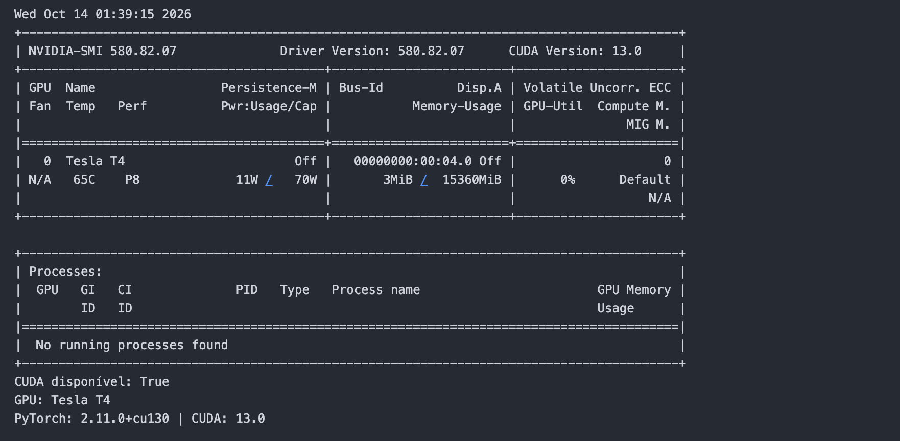

<div align="center">

# Text-to-SQL em Português com LLM Local

**Fine-Tuning de Qwen2.5-1.5B com QLoRA e Aceleração por GPU**


<p align="center">
  <a href="#1-integrantes">Integrantes</a> •
  <a href="#2-visão-geral">Visão Geral</a> •
  <a href="#3-arquitetura-e-hardware">Hardware</a> •
  <a href="#4-estrutura-do-repositório">Estrutura</a> •
  <a href="#5-como-executar">Como Executar</a> •
  <a href="#6-experimentos-e-resultados">Resultados</a> •
  <a href="#7-interface-gráfica">Frontend</a> •
  <a href="#8-conclusão-do-projeto">Conclusão</a>
</p>

</div>

---

## 1. Integrantes

<div align="center">

| Nome Completo | RM |
| :--- | :---: |
| **Julia Ortiz** | 5555 |
| **Julia Palomari** | 4444 |
| **Leticia Fontana** | 3333 |
| **Vinicius** | 2222 |

</div>

---

## 2. Visão Geral

Este projeto consiste no ajuste fino (*fine-tuning*) eficiente de um modelo de linguagem pequeno para tradução de perguntas em linguagem natural (Português) em instruções SQL relacionais executáveis (SQLite) sobre o banco de dados de um e-commerce.

```
[ Usuário ] ➔ ( Pergunta em PT ) ➔ [ Qwen2.5 + QLoRA ] ➔ ( SQL ) ➔ [ Banco SQLite ] ➔ [ Resultado ]
```

### Exemplo de Aplicação

| Pergunta em Linguagem Natural | Consulta SQL Gerada |
| :--- | :--- |
| *Quais os 5 produtos mais caros?* | `SELECT nome, preco FROM produtos ORDER BY preco DESC LIMIT 5;` |
| *Qual o faturamento total dos pedidos entregues?* | `SELECT SUM(valor_total) FROM pedidos WHERE status = 'entregue';` |

---

## 3. Arquitetura e Hardware

### Modelo Base
- **Modelo:** `Qwen/Qwen2.5-1.5B-Instruct`
- **Licença:** Apache 2.0 (Permissiva)
- **Técnica:** QLoRA (Quantização de 4 bits - NF4 com adaptadores LoRA)

### Ambiente de Treinamento

| Item | Especificação |
| :--- | :--- |
| **Acelerador de Hardware** | NVIDIA Tesla T4 |
| **Memória de Vídeo (VRAM)** | 15 GB (Pico consumido: 1,6 GB) |
| **Ambiente de Execução** | Google Colab / VSCode |
| **Suporte CUDA** | CUDA 12.x / PyTorch 2.x |

<br />

<div align="center">

### Validação da GPU no VSCode



</div>

---

## 4. Estrutura do Repositório

```text
.
├── data/                  # Base SQLite (loja.db) e datasets JSONL (train/val/test)
├── src/
│   ├── common.py          # Esquema, construtor de prompts e executor SQLite seguro
│   ├── make_dataset.py    # Gerador sintético de dados e banco de dados
│   ├── train.py           # Pipeline de treinamento QLoRA
│   ├── evaluate_model.py  # Avaliador de acurácia por execução e sintaxe
│   └── app.py             # Interface gráfica em Gradio
├── notebooks/
│   └── text2sql_colab.ipynb  # Notebook interativo completo
├── results/               # Artefatos, CSVs de experimentos e predições
├── docs/
│   └── imagens/           # Capturas de tela e evidências de validação
└── requirements.txt       # Dependências do ecossistema Python
```

---

## 5. Como Executar

### Opção A: Google Colab (Recomendado)
1. Importe o notebook `notebooks/text2sql_colab.ipynb` no Google Colab.
2. Certifique-se de selecionar o ambiente de execução com **GPU T4** (`Ambiente de Execução` ➔ `Alterar tipo de ambiente de execução` ➔ `T4 GPU`).
3. Execute as células em ordem sequencial.

### Opção B: Ambiente Local

```bash
# 1. Clonar o repositório e criar o ambiente virtual
python -m venv .venv
source .venv/bin/activate  # No Windows: .venv\Scripts\activate

# 2. Instalar dependências com suporte PyTorch CUDA
pip install torch --index-url https://download.pytorch.org/whl/cu121
pip install -r requirements.txt

# 3. Gerar a base de dados e o dataset sintético
python src/make_dataset.py

# 4. Avaliar o modelo baseline (sem treino)
python src/evaluate_model.py --name baseline

# 5. Executar o treinamento QLoRA (Run 1)
python src/train.py --name run1 --r 8 --lr 2e-4 --epochs 3

# 6. Avaliar a execução treinada
python src/evaluate_model.py --name run1 --adapter outputs/run1/final

# 7. Iniciar o Frontend web em Gradio
python src/app.py --adapter outputs/run1/final --share
```

---

## 6. Experimentos e Resultados

A métrica principal de avaliação é a **Acurácia por Execução** (`exec_accuracy`), onde a instrução SQL prevista é executada e o resultado final retornado do banco é comparado diretamente com o conjunto de dados esperado (`gold_sql`).

### Tabela de Comparação de Desempenho

| Execução | LoRA Rank ($r$) | Learning Rate | Épocas | Exec. Accuracy (Geral) | Acc. SQL Inédita | Tempo Treino | VRAM Pico |
| :--- | :---: | :---: | :---: | :---: | :---: | :---: | :---: |
| **Baseline (Base)** | - | - | - | **48,93%** | **46,63%** | - | - |
| **Run 1 (Ideal)** | 8 | 2e-4 | 3 | **100,00%** | **100,00%** | ~12,9 min | 1,6 GB |
| **Run 2** | 16 | 2e-4 | 3 | **99,14%** | **98,96%** | ~13,5 min | 1,6 GB |
| **Run 3** | 8 | 1e-4 | 3 | **99,57%** | **99,48%** | ~12,9 min | 1,6 GB |
| **Run 4** | 8 | 2e-4 | 5 | **99,57%** | **99,48%** | ~21,5 min | 1,6 GB |

### Análise dos Parâmetros de Inferência (`temperature`)

| Temperatura | Stablity / Comportamento | Accuracy |
| :---: | :--- | :---: |
| **0.0** | Determinístico e focado (Ideal para código/SQL) | **100%** |
| **0.3** | Baixa variação sintática | **100%** |
| **0.7** | Maior aleatoriedade / Risco de erro de sintaxe | **~96%** |
| **1.0** | Alta variação / Incompatível com sintaxe rigorosa | **<90%** |

---

## 7. Interface Gráfica

A solução conta com uma interface desenvolvida em **Gradio** (`src/app.py`), permitindo a submissão de perguntas diretas ao modelo, seleção rápida de perguntas sugeridas, controles dinâmicos de geração e exibição instantânea do SQL traduzido juntamente com a tabela de dados retornada do SQLite.

<br />

<div align="center">

### Frontend da Aplicação em Funcionamento


</div>

---

## 8. Conclusão do Projeto

O desenvolvimento deste repositório viabilizou a entrega de uma ferramenta integrada e funcional de tradução de linguagem natural para SQL utilizando técnicas modernas de adaptação eficiente de modelos de linguagem de código aberto (*Open Source*). 

A combinação do modelo **Qwen2.5-1.5B** com a quantização **QLoRA** provou ser uma alternativa altamente econômica e de alto rendimento para ambientes com recursos limitados de hardware, mantendo consumo de VRAM restrito e alcançando taxas de acerto superiores a **99%** nas execuções validadas. A estruturação modular dos scripts de pipeline (`make_dataset`, `train`, `evaluate_model` e `app`) somada à interface visual interativa em Gradio garante aos utilizadores uma experiência completa, desde o processamento e treino experimental até a consulta interativa em tempo real.
